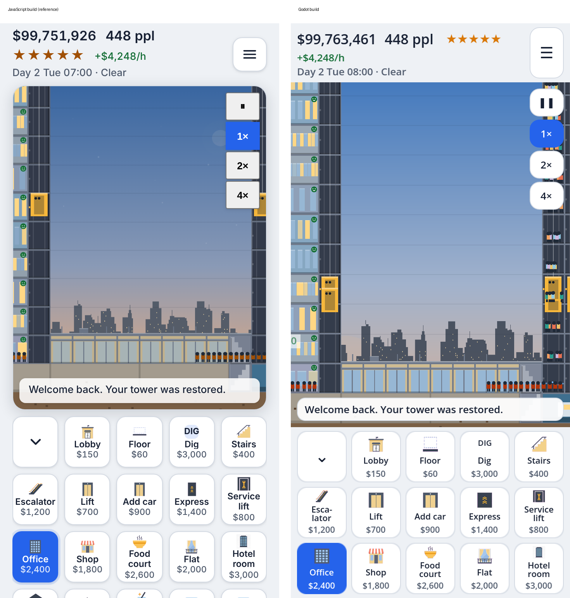

# Skyrise in Godot

A Godot 4.7 rewrite of Skyrise, kept beside the JavaScript build in the same repository.
The JS build (repo root) stays the reference: the simulation here is checked against it
value by value, and both builds read and write the same tower files.



## Run it

```sh
bash studio/setup-godot.sh          # cloud sessions only: installs Godot 4.7.2 (about 4 minutes)
cd godot
godot --headless --path . --import  # first run only
godot --path .                      # play on the desktop (needs a display)
bash run_checks.sh                  # every check (below); exports the web build to build/web
```

To play the web build, serve the repo root and open `/godot/build/web/` (any static host
works: the export is single-threaded, so it needs no special headers).

Dev URL options for the web build: `?debug` publishes a JSON summary on
`window.__skyrise` for the browser checks, `?demo=big` starts with a five-star tower of
233 structures, and `?skip=bg,base,grid,st,ppl,tb,hud,ov` switches drawing layers off
for profiling.

## How it maps to the JS build

| JS (repo root) | Godot (`godot/`) | Notes |
|---|---|---|
| `src/constants.js` | `sim/constants.gd` | Same names and numbers. |
| `src/sim.js` | `sim/sim.gd` | Line-for-line port; state and structures are Dictionaries with the JS field names. |
| `src/tenants.js`, `src/draft.js`, `src/seasons.js` | `sim/tenants.gd`, `sim/draft.gd`, `sim/seasons.gd` | `trackFor` from `src/audio.js` is in `seasons.gd`. |
| `Math.imul`, `>>>`, `Math.round`, `anim.js` `hash01` | `sim/hashing.gd` | 32-bit JS maths reproduced exactly, so tenant names, looks and weather match. |
| `src/render.js`, `src/input.js` | `game/tower_view.gd` | Same drawing, in Godot's canvas. |
| `src/ui.js`, `index.html`, `styles.css` | `game/ui.gd`, `game/tool_grid.gd`, `game/palette.gd` | Built in code; the palette is the CSS tokens. |
| `src/main.js` | `game/main.gd` | The same tools, cards, sheets, messages and guide. |
| `src/storage.js` | `game/storage.gd` | See saves below. |
| `src/audio.js` | `game/audio.gd` | The same MP3s, synced from `../assets` by `tools/sync_assets.sh`. |
| `tests/run.js` | `tests/run_tests.gd` | 28 tests of the sim-level rules. |

## How it is checked

`run_checks.sh` runs all of these; the last run passed every one.

- **Parity with the JS sim.** `tools/parity.mjs` (JS) and `tests/parity.gd` (Godot) run
  the five scripted towers in `tests/parity_scenarios.json` with the same seeded RNG,
  and `tools/compare.mjs` diffs every snapshot: **181 snapshots, 316,892 values,
  0 differences**. The towers cover lifts, express shafts, sky lobbies, closed stops, the
  basement, car parks, transit, hotels and housekeeping, food courts, event halls, fires,
  burnt shells and repairs, a loan and game over, a VIP review, tenants moving out,
  renames, rent levels and a JSON save round trip. The check is sensitive: changing one
  tuning number by one point gives 4,217 differences.
- **Unit tests.** `tests/run_tests.gd`, 28 tests: placement and support, paths, economy,
  saves (corrupt, v1, v6 grandfathering), shafts and cars, star gates, flat sales, lift
  waits, people, hotels, the basement, fires, the VIP, the loan, a five-star tower with
  the Sky Garden, drafts, the guide, mood, names and weather. A script error or a hang
  fails the run.
- **Browser checks at 360x740.** `tests/web_check.js`, 21 checks through real taps on the
  web build: the Sprint 7 traps (lift on the lobby, no-path warning before paying), the
  guide, offices letting at 4x, the inspect and demolish cards, the tower sheet, save and
  reload, the quarter report, the dark theme, no script errors.
- **Shared saves.** `tests/interop_check.js`, 5 checks: a tower saved by the JS build
  loads in the Godot build, and a tower saved by Godot loads in the JS build.

## Saves

On the web, towers and settings live in `localStorage` under the JS build's own keys
(`skyrise.save.1` to `.3`, `skyrise.slot`, `skyrise.theme` and so on), in the same JSON.
So the two builds served from one site share their towers, and a save is written before
the next line runs. Godot's own `user://` reaches IndexedDB asynchronously, and the
browser checks caught a reload losing a save made just before it. On the desktop, each key
is a file in `user://`. Export downloads the tower file on the web and writes it to
`user://` on the desktop; Import is on the web only.

## Performance

Measured in headless Chromium with a software GPU (SwiftShader), which is far slower
than any phone GPU, so these are worst cases:

| | JS build | Godot build |
|---|---|---|
| Starter tower | 16.7 ms/frame (60 fps) | 33 ms/frame (30 fps) |
| Five-star tower, 233 structures | 16.7 ms/frame | 33-50 ms/frame |
| Godot tower view alone, UI hidden | | 16.7-33 ms/frame |

These runs share a busy machine, so a reading can vary by one frame interval
(16.7 ms) from run to run; the ranges above are what repeated runs gave.

Script time is small (about 2 ms a frame for the live layer, 4-6 ms once per game hour for
the cached layer). The rest is rendering. Three changes brought the five-star tower from
100 ms to 33-50 ms:
- **Cached static layer.** The sky, ground, basement, grid and buildings render into a
  texture that is redrawn only on a tick, a camera move or a build. The JS build caches
  its background canvas the same way.
- **One texture for the live layer.** Godot never batches polygons, so faces, people, lift
  cars and dust draw from one texture as batched quads.
- **A custom-drawn toolbar.** All 25 tools are one control drawn in a single pass, instead
  of a grid of button nodes.

Not measured: a real phone. The 30 fps floor in the table is from the emulated GPU.

## Size

| | Download, gzip |
|---|---|
| JS build, without audio | 1.2 MB |
| Godot engine (`index.wasm`) | 9.6 MB |
| Godot game data (`index.pck`, incl. audio and the DejaVu font) | 3.7 MB |

Serve the `.wasm` compressed.

## Not ported yet

- Festival decorations: the CNY lanterns, Christmas lights, Merdeka flag, fireworks and
  the sled. Festival music, greetings and Christmas snow are in.
- The JS build's dev overrides (`?date`, `?festival`, `?weather`, `?fire`, `?over`).
- Accessibility: the JS build's buttons have labels a screen reader can read; Godot draws
  to a canvas, which a screen reader cannot read.
- Small touches: the HUD flash and star bump animations, vibration on demolish and fire,
  sheet transitions, the stage's rounded corners. Import on the desktop.
- Reduced motion follows the browser on the web; on the desktop it is always off.

## Notes

- `assets/fonts/DejaVuSans.ttf` (free licence, `assets/fonts/LICENSE-DejaVu.txt`) is the
  fallback font for ★ ☆ ♛ ✓ ✗, which Godot's default font lacks.
- Godot's `JSON.stringify` leaves control characters in strings unescaped. Saves never
  contain any, because `clean_name` strips them from names.
