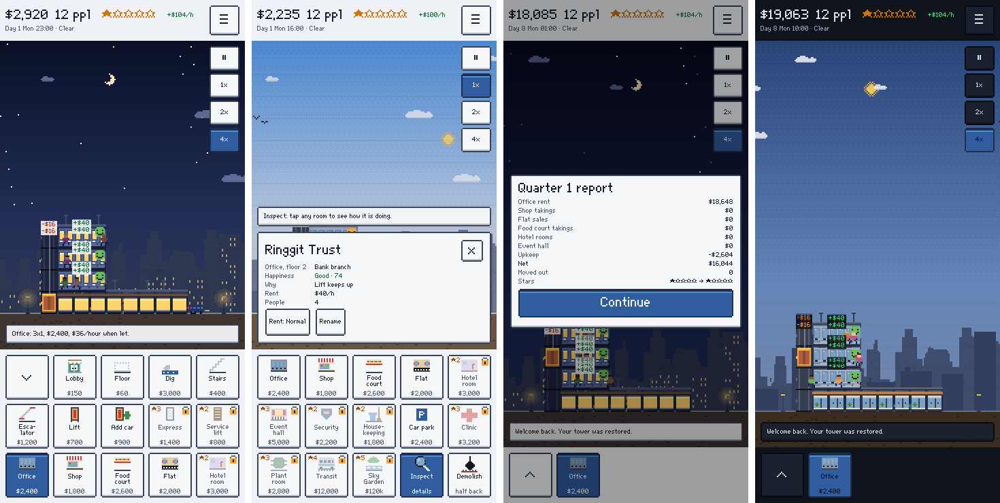
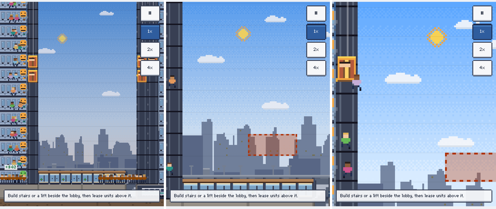

# Skyrise in Godot

A Godot 4.7 rewrite of Skyrise, kept beside the JavaScript build in the same repository.
The JS build (repo root) stays the reference: the simulation here is checked against it
value by value, and both builds read and write the same tower files.

The Godot build looks and sounds different: it is a pixel-art tower sim with chiptune
music. Every sprite, the font and every sound are generated by two scripts in `tools/`
(below), so the art and audio are originals that can be rebuilt and edited as code.






## Run it

```sh
bash studio/setup-godot.sh          # cloud sessions only: installs Godot 4.7.2 (about 4 minutes)
cd godot
godot --headless --path . --import  # first run only
godot --path .                      # play on the desktop (needs a display)
bash run_checks.sh                  # every check (below); exports the web build to build/web
```

To play the web build, serve the repo root and open `/godot/build/web/` (any static host
works: the export is single-threaded, so it needs no special headers).

Dev URL options for the web build: `?debug` publishes a JSON summary on
`window.__skyrise` for the browser checks, `?demo=big` starts with a five-star tower of
233 structures, and `?skip=bg,base,grid,st,ppl,tb,hud,ov` switches drawing layers off
for profiling.

## How it maps to the JS build

| JS (repo root) | Godot (`godot/`) | Notes |
|---|---|---|
| `src/constants.js` | `sim/constants.gd` | Same names and numbers. |
| `src/sim.js` | `sim/sim.gd` | Line-for-line port; state and structures are Dictionaries with the JS field names. |
| `src/tenants.js`, `src/draft.js`, `src/seasons.js` | `sim/tenants.gd`, `sim/draft.gd`, `sim/seasons.gd` | `trackFor` from `src/audio.js` is in `seasons.gd`. |
| `Math.imul`, `>>>`, `Math.round`, `anim.js` `hash01` | `sim/hashing.gd` | 32-bit JS maths reproduced exactly, so tenant names, looks and weather match. |
| `src/render.js`, `src/input.js` | `game/tower_view.gd`, `game/sky.gdshader`, `game/pixel.gd` | Redrawn as pixel art (see below); the same taps, drags, pinch and wheel. |
| `src/ui.js`, `index.html`, `styles.css` | `game/ui.gd`, `game/tool_grid.gd`, `game/palette.gd` | Built in code; the palette is the CSS tokens, with pixel panels, buttons, icons and font. |
| `src/main.js` | `game/main.gd` | The same tools, cards, sheets, messages and guide. |
| `src/storage.js` | `game/storage.gd` | See saves below. |
| `src/audio.js`, `tools/audio/score.mjs` | `game/audio.gd`, `assets/chip/` | The JS build's own tunes, re-rendered as chiptune stems with layers (see below). |
| `tests/run.js` | `tests/run_tests.gd` | 28 tests of the sim-level rules. |

## Pixel art

`python3 tools/pixelart/build.py` (repo root; needs numpy and Pillow) draws every sprite in
code from one 48-colour palette and writes `assets/pixel/`: one atlas (`atlas.png` +
`atlas.json`), the pixel font (`font.png` + `font.json`) and `preview.png`, every sprite at
4x with its name, for reviewing the art.

- **The grid.** A room cell is 12x16 art pixels. The game shows art pixels at an integer
  zoom of 1 to 4 (2 on a phone), so every pixel stays square: pinch, the wheel and the zoom
  buttons step between whole zooms, and the camera snaps to whole pixels. The project uses
  the `viewport` stretch mode with integer scaling and nearest filtering.
- **The tower.** Each business has its own facade (four kinds of office, eight shops,
  four flats, the restaurants, hotel rooms clean and dirty, the halls), with a window
  overlay that lights up room by room as dusk falls. Lifts have cars with opening doors,
  people walk with skin, hair and shirt colours, queues colour with stress, and fires,
  smoke, burnt shells, To Let boards and parapets, tanks and aerials on the roof are all
  sprites.
- **The world.** The sky is a shader (`game/sky.gdshader`): flat colour bands with an
  ordered dither between them, a warm horizon at dawn and dusk and twinkling stars at
  night. Behind the tower are a pixel skyline, near buildings, trees and street lamps; in
  front, the sun and moon cross the sky, clouds drift, birds flock and cars drive by. Rain
  and snow fall as pixels.
- **The interface.** A proportional 5x7 pixel font, pixel panels and buttons (9-slice), and
  a 12x12 icon for each of the 24 tools, all drawn at 1x or 2x.
- **Drawing cost.** Everything comes from the one atlas, so it batches. The skyline and
  ground, and the tower's structures, render into two cached layers that are redrawn only
  on a tick, a camera move or a build; only faces, people, lift cars and effects draw each
  frame.

## Chiptune sound

`tools/chiptune/render.py` (needs numpy and ffmpeg) plays the JS build's score
(`tools/audio/score.mjs`, exported to `tools/chiptune/score.json`; the commands are at the
top of the script) on a small sound chip: two pulse channels at 12.5, 25 and 50% duty, a
stepped triangle and a noise channel, with volume in 16 steps. It writes 50 Ogg files to
`assets/chip/`: four stems per tune, three ambience loops and the cues. It is seeded, so a
re-render gives the same files.

`game/audio.gd` mixes them live:
- **Layered music.** A tune's lead, bass, arp and drums play in sync
  (`AudioStreamSynchronized`). The drums come in at 2 stars and the arp at 3, and weekday
  rush hours lift both, so the music grows with the tower. Day, night and festival tunes
  crossfade over two seconds.
- **Ambience.** Day traffic and birds, night crickets and rain, faded by the hour and the
  weather.
- **Placed cues.** Rent coming in, a lift arriving and a tenant moving in play from their
  point in the tower, so they pan left and right.
- **Mixing.** Music, SFX and Ambience buses; the music is muffled by a low-pass filter
  while a sheet is open, and a limiter on the master bus stops clipping.

## How it is checked

`run_checks.sh` runs all of these; the last run passed every one.

- **Parity with the JS sim.** `tools/parity.mjs` (JS) and `tests/parity.gd` (Godot) run
  the five scripted towers in `tests/parity_scenarios.json` with the same seeded RNG,
  and `tools/compare.mjs` diffs every snapshot: **181 snapshots, 316,892 values,
  0 differences**. The towers cover lifts, express shafts, sky lobbies, closed stops, the
  basement, car parks, transit, hotels and housekeeping, food courts, event halls, fires,
  burnt shells and repairs, a loan and game over, a VIP review, tenants moving out,
  renames, rent levels and a JSON save round trip. The check is sensitive: changing one
  tuning number by one point gives 4,217 differences.
- **Unit tests.** `tests/run_tests.gd`, 28 tests: placement and support, paths, economy,
  saves (corrupt, v1, v6 grandfathering), shafts and cars, star gates, flat sales, lift
  waits, people, hotels, the basement, fires, the VIP, the loan, a five-star tower with
  the Sky Garden, drafts, the guide, mood, names and weather. A script error or a hang
  fails the run.
- **Audio wiring.** `tests/audio_check.gd`: the buses and their effects, every tune's four
  stems loaded and looping, layers coming in with stars, the duck, the ambience, the
  crossfade and the placed cues. It runs with the dummy audio driver, so it checks the
  wiring, not how the sound is heard.
- **Browser checks at 360x740.** `tests/web_check.js`, 21 checks through real taps on the
  pixel web build: the Sprint 7 traps (lift on the lobby, no-path warning before paying), the
  guide, offices letting at 4x, the inspect and demolish cards, the tower sheet, save and
  reload, the quarter report, the dark theme, no script errors.
- **Shared saves.** `tests/interop_check.js`, 5 checks: a tower saved by the JS build
  loads in the Godot build, and a tower saved by Godot loads in the JS build.

## Saves

On the web, towers and settings live in `localStorage` under the JS build's own keys
(`skyrise.save.1` to `.3`, `skyrise.slot`, `skyrise.theme` and so on), in the same JSON.
So the two builds served from one site share their towers, and a save is written before
the next line runs. Godot's own `user://` reaches IndexedDB asynchronously, and the
browser checks caught a reload losing a save made just before it. On the desktop, each key
is a file in `user://`. Export downloads the tower file on the web and writes it to
`user://` on the desktop; Import is on the web only.

## Performance

Measured in headless Chromium with a software GPU (SwiftShader), which is far slower
than any phone GPU, so these are worst cases:

| | JS build | Godot build |
|---|---|---|
| Starter tower | 16.7 ms/frame (60 fps) | 33 ms/frame (30 fps) |
| Five-star tower, 233 structures | 16.7 ms/frame | 33-50 ms/frame |

With the pixel renderer, Godot's own frame time (script and draw submission, before the
emulated GPU) is about 5 ms for the starter tower and 31 ms for the five-star tower at 2x
zoom.

These runs share a busy machine, so a reading can vary by one frame interval
(16.7 ms) from run to run; the ranges above are what repeated runs gave.

What keeps it there:
- **Cached layers.** The skyline and ground, and the tower's structures, render into
  textures that are redrawn only on a tick, a camera move or a build. The JS build caches
  its background canvas the same way.
- **One atlas.** Every sprite and the font come from one texture, so they draw as batched
  quads.
- **A custom-drawn toolbar.** All 25 tools are one control drawn in a single pass, instead
  of a grid of button nodes.

Not measured: a real phone. The 30 fps floor in the table is from the emulated GPU.

## Size

| | Download, gzip |
|---|---|
| JS build, without audio | 1.2 MB |
| Godot engine (`index.wasm`) | 9.6 MB |
| Godot game data (`index.pck`: sprites, font, 50 Ogg files) | 2.9 MB |

Serve the `.wasm` compressed.

## Not ported yet

- Festival decorations: the CNY lanterns, Christmas lights, Merdeka flag, fireworks and
  the sled. Festival music, greetings and Christmas snow are in.
- The JS build's dev overrides (`?date`, `?festival`, `?weather`, `?fire`, `?over`).
- Accessibility: the JS build's buttons have labels a screen reader can read; Godot draws
  to a canvas, which a screen reader cannot read.
- Small touches: the HUD flash and star bump animations, vibration on demolish and fire,
  sheet transitions, the stage's rounded corners. Import on the desktop.
- Reduced motion follows the browser on the web; on the desktop it is always off.

## Notes

- The pixel font has its own ★ ☆ ♛ ✓ ✗ ❚ glyphs, so no fallback font is shipped.
- The only art copied from the JS build is the app icon and the logo
  (`tools/sync_assets.sh`). The skyline and the Sky Garden sprites are the JS build's own
  pictures, reduced to the palette by `build.py`.
- Not heard: the chiptune has been checked by its waveforms and by the audio test, but no
  one has listened to it on a speaker yet.
- Godot's `JSON.stringify` leaves control characters in strings unescaped. Saves never
  contain any, because `clean_name` strips them from names.
